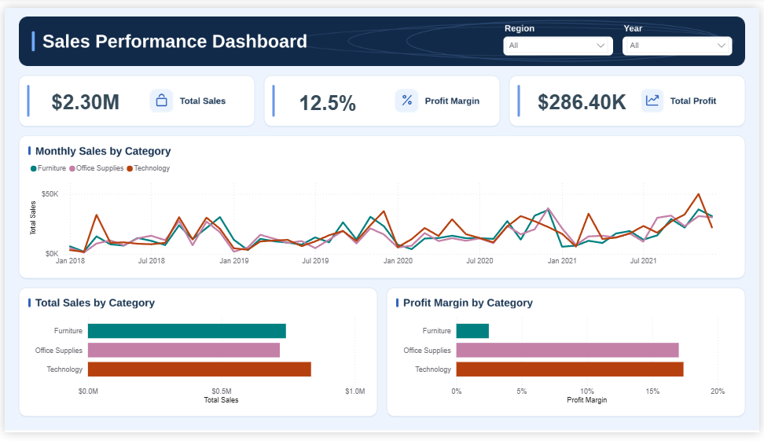

# Retail Sales & Profitability Analysis

An end-to-end MySQL and Power BI project using 9,994 Tableau Sample Superstore order lines from 2018–2021.

[View the interactive Power BI report](https://app.powerbi.com/view?r=eyJrIjoiM2RjMGFjNTUtOTFjNS00M2EyLWFjOWItMTA5Mjk1OGJmOTE0IiwidCI6ImNkY2JiMGUyLTlmZWEtNGY1NC04NjcwLTY3MjcwNzc5N2FkYSIsImMiOjEwfQ%3D%3D)

## Executive summary

### Business question

Where did sales grow between 2020 and 2021, and where did higher sales coincide with lower profit?

### Solution

I prepared the order-line data in MySQL, validated the export, and used SQL to trace changes from region to category, subcategory, and discount rate. I built a two-page Power BI report so readers can explore those same questions using slicers and interactive visuals.

| Metric | 2018–2021 result |
|---|---:|
| Total sales | $2,297,200.86 |
| Total profit | $286,397.02 |
| Profit margin | 12.5% |

## Dataset overview

| Item | Details |
|---|---|
| Source | Tableau Sample Superstore |
| Period | 2018–2021 |
| Grain | One line item per row |
| Dimensions | Order date, region, state, category, subcategory, product |
| Measures | Sales, profit, quantity, discount rate |

## Data preparation

1. **Stage the data.** Import the sample into `superstore_sales.orders_staging` with its original column headers.
2. **Prepare the export.** Parse day/month/year dates, standardize column names, and create the `orders_for_power_bi` view.
3. **Validate and report.** Check the 9,994-row count, export the view to CSV, and use the CSV in Power BI Desktop. DAX calculates profit margin and colors losses dynamically.

## Strategic analysis

| Finding | Evidence | What to investigate |
|---|---|---|
| South sold more but earned less | Sales rose $29,295.63 and profit fell $8,853.90 from 2020 to 2021. | Break down South profit by category. |
| Machines had the largest decline within South Technology | Profit moved from $4,308.11 to a $3,907.61 loss, a decline of $8,215.72. | Compare Machines order lines by discount rate. |
| South Machines losses were concentrated at the 50% discount | Four order lines at that rate in 2021 lost $4,147.60 in total, with a −43.82% margin. | Review product costs and discount decisions on those orders before changing pricing. |

## Power BI dashboard

### Sales Performance

Tracks monthly sales by category and compares category sales and margin. Use Region and Year to filter the page.



### Profitability Analysis

Ranks subcategories by profit and highlights losses in red. The matrices break down results by year and discount rate. Expand a discount row to review its yearly results.


## MySQL queries

### 1. Prepare the Power BI export

Standardizes column names and converts order dates from day/month/year text into MySQL dates. The count checks that the view contains 9,994 order lines before export.

```sql
CREATE VIEW superstore_sales.orders_for_power_bi AS
SELECT
    `Row ID` AS row_id,
    `Order ID` AS order_id,
    STR_TO_DATE(TRIM(`Order Date`), '%d/%m/%Y') AS order_date,
    `Region` AS region,
    `State` AS state,
    `Category` AS category,
    `Sub-Category` AS sub_category,
    `Product Name` AS product_name,
    `Sales` AS sales,
    `Profit` AS profit,
    `Quantity` AS quantity,
    `Discount` AS discount_rate
FROM superstore_sales.orders_staging;

SELECT COUNT(*) AS order_lines
FROM superstore_sales.orders_for_power_bi;
```

### 2. Summarize annual performance

Groups orders by year and counts distinct order IDs. Profit margin divides total profit by total sales, and NULLIF protects against division by zero.

```sql
SELECT
    YEAR(STR_TO_DATE(TRIM(`Order Date`), '%d/%m/%Y')) AS sales_year,
    COUNT(DISTINCT `Order ID`) AS total_orders,
    ROUND(SUM(`Sales`), 2) AS total_sales,
    ROUND(SUM(`Profit`), 2) AS total_profit,
    ROUND(100 * SUM(`Profit`) / NULLIF(SUM(`Sales`), 0), 2) AS profit_margin_pct
FROM superstore_sales.orders_staging
GROUP BY sales_year
ORDER BY sales_year;
```

### 3. Compare growth by category

Subtracts 2020 sales and profit from 2021 sales and profit for each category. A negative change means the metric fell.

```sql
SELECT
    category,
    ROUND(SUM(CASE WHEN sales_year = 2021 THEN sales ELSE -sales END), 2) AS sales_change,
    ROUND(SUM(CASE WHEN sales_year = 2021 THEN profit ELSE -profit END), 2) AS profit_change
FROM (
    SELECT
        `Category` AS category,
        YEAR(STR_TO_DATE(TRIM(`Order Date`), '%d/%m/%Y')) AS sales_year,
        `Sales` AS sales,
        `Profit` AS profit
    FROM superstore_sales.orders_staging
) AS order_lines
WHERE sales_year IN (2020, 2021)
GROUP BY category
ORDER BY sales_change DESC;
```

### 4. Compare growth by region

Uses the same year-over-year calculation for each region. South gained sales while losing profit.

```sql
SELECT
    region,
    ROUND(SUM(CASE WHEN sales_year = 2021 THEN sales ELSE -sales END), 2) AS sales_change,
    ROUND(SUM(CASE WHEN sales_year = 2021 THEN profit ELSE -profit END), 2) AS profit_change
FROM (
    SELECT
        `Region` AS region,
        YEAR(STR_TO_DATE(TRIM(`Order Date`), '%d/%m/%Y')) AS sales_year,
        `Sales` AS sales,
        `Profit` AS profit
    FROM superstore_sales.orders_staging
) AS order_lines
WHERE sales_year IN (2020, 2021)
GROUP BY region
ORDER BY sales_change DESC;
```

### 5. Break down South profit by category

Filters to South and orders categories by profit change so the largest decline appears first. Technology had the largest drop.

```sql
SELECT
    category,
    ROUND(SUM(CASE WHEN sales_year = 2021 THEN sales ELSE -sales END), 2) AS sales_change,
    ROUND(SUM(CASE WHEN sales_year = 2021 THEN profit ELSE -profit END), 2) AS profit_change
FROM (
    SELECT
        `Category` AS category,
        YEAR(STR_TO_DATE(TRIM(`Order Date`), '%d/%m/%Y')) AS sales_year,
        `Sales` AS sales,
        `Profit` AS profit
    FROM superstore_sales.orders_staging
    WHERE `Region` = 'South'
) AS order_lines
WHERE sales_year IN (2020, 2021)
GROUP BY category
ORDER BY profit_change ASC;
```

### 6. Find the largest decline within South Technology

Shows 2020 and 2021 profit for each Technology subcategory in South. It calculates the change before rounding. Machines had the largest decline.

```sql
SELECT
    sub_category,
    ROUND(SUM(CASE WHEN sales_year = 2020 THEN profit ELSE 0 END), 2) AS profit_2020,
    ROUND(SUM(CASE WHEN sales_year = 2021 THEN profit ELSE 0 END), 2) AS profit_2021,
    ROUND(SUM(CASE WHEN sales_year = 2021 THEN profit ELSE -profit END), 2) AS profit_change
FROM (
    SELECT
        `Sub-Category` AS sub_category,
        YEAR(STR_TO_DATE(TRIM(`Order Date`), '%d/%m/%Y')) AS sales_year,
        `Profit` AS profit
    FROM superstore_sales.orders_staging
    WHERE `Region` = 'South'
        AND `Category` = 'Technology'
) AS south_technology_orders
WHERE sales_year IN (2020, 2021)
GROUP BY sub_category
ORDER BY profit_change ASC;
```

### 7. Review South Machines by discount rate

Groups South Machines order lines by year and discount rate. Within each group, the query compares order-line volume, sales, profit, and margin.

```sql
SELECT
    sales_year,
    discount_rate * 100 AS discount_pct,
    COUNT(*) AS order_lines,
    ROUND(SUM(sales), 2) AS total_sales,
    ROUND(SUM(profit), 2) AS total_profit,
    ROUND(100 * SUM(profit) / NULLIF(SUM(sales), 0), 2) AS profit_margin_pct
FROM (
    SELECT
        YEAR(STR_TO_DATE(TRIM(`Order Date`), '%d/%m/%Y')) AS sales_year,
        `Discount` AS discount_rate,
        `Sales` AS sales,
        `Profit` AS profit
    FROM superstore_sales.orders_staging
    WHERE `Region` = 'South'
        AND `Sub-Category` = 'Machines'
) AS south_machine_orders
WHERE sales_year IN (2020, 2021)
GROUP BY sales_year, discount_rate
ORDER BY discount_rate, sales_year;
```

## Technical stack

| Tool | Role |
|---|---|
| MySQL | Staging, date parsing, export view and analytical queries |
| Power BI Desktop | Data import, report design and interactive filters |
| DAX | Profit margin and conditional formatting |

## Project structure

| Path | Contents |
|---|---|
| [data/](data/) | Prepared order-line CSV |
| [sql/](sql/) | MySQL export view and six analysis queries |
| [dax/](dax/) | Report measures |
| [powerbi/](powerbi/) | Editable Power BI report |
| [screenshots/](screenshots/) | Two dashboard previews |

## How to run

- **Open the report.** Open the [PBIX](powerbi/Sales%20Performance%20Dashboard.pbix) in Power BI Desktop. If refresh prompts for the original path, point the report to [orders_for_power_bi.csv](data/orders_for_power_bi.csv).
- **Rerun the SQL.** Import the original Tableau Sample Superstore data into `superstore_sales.orders_staging` with day/month/year text dates. Run scripts 01–07 in order.

## Dataset attribution

Tableau Sample Superstore is the source of the sample order data used in this portfolio project.

## Author

[Muhammad Firas Haiman Bin Taha](https://github.com/firashaiman)
