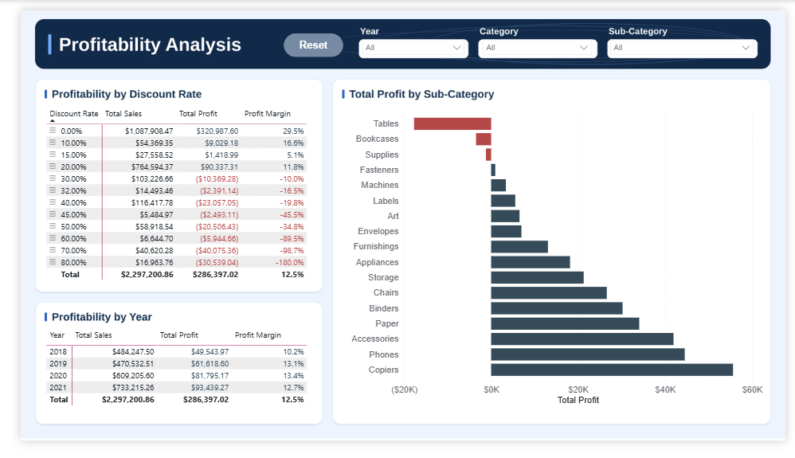

# Retail Sales & Profitability Dashboard

A two-page Power BI report built with MySQL, Power BI Desktop, and DAX using Tableau Sample Superstore order lines from 2018–2021.

[View the interactive Power BI report](https://app.powerbi.com/view?r=eyJrIjoiM2RjMGFjNTUtOTFjNS00M2EyLWFjOWItMTA5Mjk1OGJmOTE0IiwidCI6ImNkY2JiMGUyLTlmZWEtNGY1NC04NjcwLTY3MjcwNzc5N2FkYSIsImMiOjEwfQ%3D%3D)

## Sales performance

Track total sales, total profit, and margin. Compare monthly sales and category performance using the Region and Year slicers.


## Profitability analysis

Compare profit by subcategory and review sales, profit, and margin by year or discount rate. Red highlights negative results.



## SQL findings

From 2020 to 2021, South region sales rose by $29,295.63 while profit fell by $8,853.90. Within South Technology, Machines recorded the largest profit decline, down $8,215.72. South Machines orders at a 50% discount lost $4,147.60 in 2021.

## Project files

- [Power BI source report](powerbi/Sales%20Performance%20Dashboard.pbix)
- [Prepared order-line CSV](data/orders_for_power_bi.csv)
- [MySQL export view and analysis queries](sql/)
- [DAX measures](dax/report-measures.md)

Open the PBIX in Power BI Desktop. If you refresh and Power BI asks for the original CSV path, update the data source to point to the included CSV.

To rerun the SQL in MySQL, first import Tableau Sample Superstore into `superstore_sales.orders_staging` with the original column names and dates in day/month/year format. Script 01 creates the export view and checks the row count. Scripts 02–07 reproduce the analysis shown in the original SQL screenshots.

## MySQL queries

### 1. Prepare the Power BI export

Standardizes column names and converts order dates from day/month/year text into MySQL dates. The count checks that the view contains 9,994 order lines before export.

```sql
CREATE VIEW superstore_sales.orders_for_power_bi AS
SELECT
    `Row ID` AS row_id,
    `Order ID` AS order_id,
    STR_TO_DATE(TRIM(`Order Date`), '%d/%m/%Y') AS order_date,
    `Region` AS region,
    `State` AS state,
    `Category` AS category,
    `Sub-Category` AS sub_category,
    `Product Name` AS product_name,
    `Sales` AS sales,
    `Profit` AS profit,
    `Quantity` AS quantity,
    `Discount` AS discount_rate
FROM superstore_sales.orders_staging;

SELECT COUNT(*) AS order_lines
FROM superstore_sales.orders_for_power_bi;
```

### 2. Summarize annual performance

Groups orders by year and counts distinct order IDs. Profit margin divides total profit by total sales, and NULLIF protects against division by zero.

```sql
SELECT
    YEAR(STR_TO_DATE(TRIM(`Order Date`), '%d/%m/%Y')) AS sales_year,
    COUNT(DISTINCT `Order ID`) AS total_orders,
    ROUND(SUM(`Sales`), 2) AS total_sales,
    ROUND(SUM(`Profit`), 2) AS total_profit,
    ROUND(100 * SUM(`Profit`) / NULLIF(SUM(`Sales`), 0), 2) AS profit_margin_pct
FROM superstore_sales.orders_staging
GROUP BY sales_year
ORDER BY sales_year;
```

### 3. Compare growth by category

Subtracts 2020 sales and profit from 2021 sales and profit for each category. A negative change means the metric fell.

```sql
SELECT
    category,
    ROUND(SUM(CASE WHEN sales_year = 2021 THEN sales ELSE -sales END), 2) AS sales_change,
    ROUND(SUM(CASE WHEN sales_year = 2021 THEN profit ELSE -profit END), 2) AS profit_change
FROM (
    SELECT
        `Category` AS category,
        YEAR(STR_TO_DATE(TRIM(`Order Date`), '%d/%m/%Y')) AS sales_year,
        `Sales` AS sales,
        `Profit` AS profit
    FROM superstore_sales.orders_staging
) AS order_lines
WHERE sales_year IN (2020, 2021)
GROUP BY category
ORDER BY sales_change DESC;
```

### 4. Compare growth by region

Uses the same year-over-year calculation for each region. South gained sales while losing profit.

```sql
SELECT
    region,
    ROUND(SUM(CASE WHEN sales_year = 2021 THEN sales ELSE -sales END), 2) AS sales_change,
    ROUND(SUM(CASE WHEN sales_year = 2021 THEN profit ELSE -profit END), 2) AS profit_change
FROM (
    SELECT
        `Region` AS region,
        YEAR(STR_TO_DATE(TRIM(`Order Date`), '%d/%m/%Y')) AS sales_year,
        `Sales` AS sales,
        `Profit` AS profit
    FROM superstore_sales.orders_staging
) AS order_lines
WHERE sales_year IN (2020, 2021)
GROUP BY region
ORDER BY sales_change DESC;
```

### 5. Break down South profit by category

Filters to South and orders categories by profit change so the largest decline appears first. Technology had the largest drop.

```sql
SELECT
    category,
    ROUND(SUM(CASE WHEN sales_year = 2021 THEN sales ELSE -sales END), 2) AS sales_change,
    ROUND(SUM(CASE WHEN sales_year = 2021 THEN profit ELSE -profit END), 2) AS profit_change
FROM (
    SELECT
        `Category` AS category,
        YEAR(STR_TO_DATE(TRIM(`Order Date`), '%d/%m/%Y')) AS sales_year,
        `Sales` AS sales,
        `Profit` AS profit
    FROM superstore_sales.orders_staging
    WHERE `Region` = 'South'
) AS order_lines
WHERE sales_year IN (2020, 2021)
GROUP BY category
ORDER BY profit_change ASC;
```

### 6. Find the largest decline within South Technology

Shows 2020 and 2021 profit for each Technology subcategory in South. It calculates the change before rounding. Machines had the largest decline.

```sql
SELECT
    sub_category,
    ROUND(SUM(CASE WHEN sales_year = 2020 THEN profit ELSE 0 END), 2) AS profit_2020,
    ROUND(SUM(CASE WHEN sales_year = 2021 THEN profit ELSE 0 END), 2) AS profit_2021,
    ROUND(SUM(CASE WHEN sales_year = 2021 THEN profit ELSE -profit END), 2) AS profit_change
FROM (
    SELECT
        `Sub-Category` AS sub_category,
        YEAR(STR_TO_DATE(TRIM(`Order Date`), '%d/%m/%Y')) AS sales_year,
        `Profit` AS profit
    FROM superstore_sales.orders_staging
    WHERE `Region` = 'South'
        AND `Category` = 'Technology'
) AS south_technology_orders
WHERE sales_year IN (2020, 2021)
GROUP BY sub_category
ORDER BY profit_change ASC;
```

### 7. Review South Machines by discount rate

Groups South Machines order lines by year and discount rate. Within each group, the query compares order-line volume, sales, profit, and margin.

```sql
SELECT
    sales_year,
    discount_rate * 100 AS discount_pct,
    COUNT(*) AS order_lines,
    ROUND(SUM(sales), 2) AS total_sales,
    ROUND(SUM(profit), 2) AS total_profit,
    ROUND(100 * SUM(profit) / NULLIF(SUM(sales), 0), 2) AS profit_margin_pct
FROM (
    SELECT
        YEAR(STR_TO_DATE(TRIM(`Order Date`), '%d/%m/%Y')) AS sales_year,
        `Discount` AS discount_rate,
        `Sales` AS sales,
        `Profit` AS profit
    FROM superstore_sales.orders_staging
    WHERE `Region` = 'South'
        AND `Sub-Category` = 'Machines'
) AS south_machine_orders
WHERE sales_year IN (2020, 2021)
GROUP BY sales_year, discount_rate
ORDER BY discount_rate, sales_year;
```
